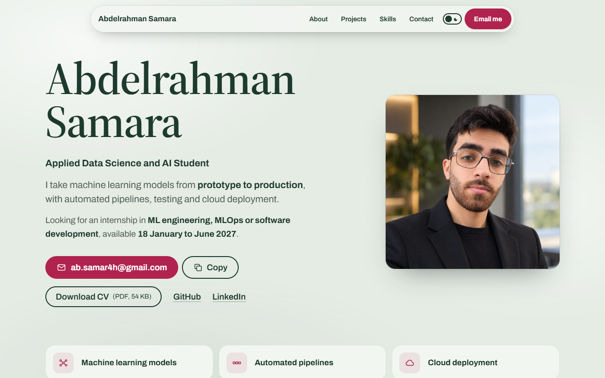

# Abdelrahman Samara’s portfolio




My one-page portfolio as an Applied Data Science and AI student. It shows what I build, from root detection and robot control to an NLP pipeline and MLOps on Azure, and makes it easy to email me.

**Live site:** [abdelrahman-samara.vercel.app](https://abdelrahman-samara.vercel.app)

## The idea

The page is built for recruiters and engineers who skim. The top section says who I am, what internship I'm looking for and when, and puts my email address first, with a Copy button for anyone without a mail app. Every section opens with a centred heading and one short sentence, and every project leads with evidence: its title, then its key result as a short highlighted line (with the number first where there is one), and a visual of real work. That visual is a screenshot, a small chart of real numbers, or a diagram of how the project works, where filled nodes mark the parts I built and outlined nodes the team's. The details sit behind each project's Read more button, result first, next to a link to the project's code on GitHub.

Filter buttons above the projects show only ML engineering, Data or Software work. The main projects are rows that alternate the visual left and right, and they open with one story: my solo root detection prototype for NPEC, then the platform that took it to production, joined by a short card between the two. The smaller projects sit in an even grid of cards, and the skills in one card per area.

In the summaries, results and What I built lists, the key words are bold and darker than the rest, so a skimming reader picks them out first.

### Motion

The page has one main moment: when it opens, my photo is scanned in from top to bottom like a petri dish on a lab scanner, and my name inks in. After that, lines move the way data flows: charts grow from their baseline and diagrams draw from step to step the first time they scroll into view, the robot inoculates the 15 root tips of the three test dishes one by one, a sample travels through the platform's pipeline (and again when you point at it), the skill tags slide into their cards, and the line between the two NPEC projects grows as you scroll. Visitors who turn on reduced motion in their system settings see the finished page straight away, with nothing moving.

### Colours and themes

The page has a light and a dark theme. It follows the visitor's device setting, and the switch in the header changes it (the choice is remembered). To compare the two side by side, open the site with `?theme=light` and `?theme=dark` at the end of the address.

The colours come from a plant lab, after my plant root projects. They are named for their job rather than their shade, because each theme fills them in differently:

| Token | Light theme | Dark theme | Used for |
| --- | --- | --- | --- |
| `page` | `#e5ece4` sage, like agar under lab light | `#0a130f` near-black green, like a scanner bed | The page background |
| `band` | `#dde5dd` | `#111b16` | The slightly different tone every other section sits on |
| `surface` | `#f2f6f1` | `#18271f` | Cards, always a little lighter than what is behind them |
| `ink` | `#1e3a2f` moss | `#e5ece4` sage | Text, outlines and the emphasised bar in charts |
| `ink-soft` | `#4d5c55` lichen | `#b6c4ba` | Body text, labels and captions |
| `accent` | `#b0234f` safranin | `#c4345f` | Buttons such as Email me and the active filter, after the red stain used on plant tissue |
| `accent-hover` | `#8e1b40` | `#a92a52` | A red button when pointed at |
| `accent-line` | `#b0234f` | `#de5279` | Icons, focus outlines, and the underline of a link you point at |
| `accent-tint` | safranin at 10% | `#de5279` at 14% | The squares behind icons, and the current section in the navigation |
| `accent-text` | `#b0234f` | `#e5ece4` (the ink) | Red text, such as a link you point at |
| `bar-muted` | `#6b7d71` fern | `#6f8a7b` | The other bars in charts |

Text needs more contrast than a line, and on a dark page a red light enough for text turns pink. So the dark theme keeps red for icons and outlines (`accent-line`) and lets text stay in the ink colour (`accent-text`); a link you point at then shows a red underline instead of red text.

Red appears only on buttons, active states, icons and links; the charts and diagrams are drawn in the ink colour. Behind the page, soft pools of lighter green drift slowly as you scroll, like light reflecting on glass, so the background is never one flat colour.

Two typefaces, both served from this site rather than Google Fonts: [Source Serif 4](https://fonts.google.com/specimen/Source+Serif+4) for my name, the section headings and the project titles, and [Archivo](https://fonts.google.com/specimen/Archivo) for everything else. Source Serif 4 has optical sizes, so its letters get finer as they get larger, and a weight axis, so the name can ink in from thin to its full weight. The big size steps grow by about 1.414 from the 18px body text (36px project titles, 51px section headings), so headings, titles and text never look alike. Every text colour passes WCAG AA contrast in both themes, and body text stays under about 70 characters a line.

## Run it locally

You need [Node.js](https://nodejs.org/) 22.12 or newer (any current LTS release works).

```bash
npm install       # install the packages listed in package.json
npm run dev       # live preview at http://localhost:5173, refreshes when you save
npm run build     # type-check, then build the finished site into dist/
npm run preview   # serve the finished build locally
npm run lint      # check the code for common mistakes with Oxlint
```

## Change the content

Almost all the text lives in `src/data`, so you rarely need to touch the layout to update the page.

| File | What it holds |
| --- | --- |
| `src/data/projects.ts` | Every project, in page order: its text, key result and visual, and the types that describe them |
| `src/data/profile.ts` | Name, title, intro, the internship I'm looking for, About, email, links, and the photo's path and size |
| `src/data/skills.ts` | Skill groups, matching the CV, each with its icon |
| `src/data/site.ts` | The sentence under each section heading, and the three tiles under the top section |
| `src/data/glossary.ts` | The plain-language explanation for each marked technical term |
| `index.html` | The browser tab title, the search and link-preview descriptions, and a short message for visitors without JavaScript that repeats the email and the CV link |

Projects come in two kinds. A main project has `kind: 'main'` and a `details` object for its Read more panel. A smaller one has `kind: 'small'`, a short `summary`, and optional `more` text that sits behind its Read more button. Every project has a `keyResult`, a `visual` and `categories` (which filter buttons show it: `'ml'`, `'data'` or `'software'`), and a `codeUrl` adds a View code link. Keep the key result short and put the number first where there is one, marked as a key word, like `'**15 of 15** root tips within 1 mm'`; the number then shows in the heaviest weight. TypeScript checks every entry when you run `npm run build`, so a missing field, or a typo in a field name, stops the build with a message pointing at the line.

To make words stand out as key words, put double asterisks around them, as in Markdown: `'I trained the **clustering model**'`. Mark results and the parts I built, not the team's.

To give a technical term a plain-language explanation, put it in double square brackets, like `'set up [[CI/CD]]'`, and add the explanation to `src/data/glossary.ts` under the same name. The term then gets a dotted underline, and tapping it, pointing at it or tabbing to it shows the explanation. Screen readers hear it as the term's description.

A visual's `caption` is optional: leave it out when the visual explains itself. Each project's skills are listed inside its Read more panel.

`npecStory` at the top of `projects.ts` joins the two NPEC projects into one story: it names the prototype and the production project by their ids, and holds the sentence shown between them. If an id doesn't match, the page simply shows both projects on their own.

To add a smaller project, copy an existing `kind: 'small'` entry in `projects.ts` and change its text:

```ts
{
  kind: 'small',
  id: 'my-new-project', // The id is used in the page's HTML ids, so keep it lowercase with dashes.
  title: 'My new project',
  summary: 'Two or three sentences about what I built and how, with **key words** marked.',
  more: 'Any further detail, shown when the visitor presses Read more.',
  period: 'March to May 2027',
  skills: ['Python', 'scikit-learn'],
  keyResult: '**3** results to remember, number first',
  codeUrl: 'https://github.com/AbdelrahmanSamara245769/my-new-project',
  categories: ['ml'],
  visual: {
    type: 'flow',
    caption: 'How it works.',
    steps: [
      { label: 'First step', mine: true },
      { label: 'Second step', mine: true },
    ],
  },
},
```

A visual can be one of five types:

- **`image`:** a screenshot. Put the file in `public/projects/`, set `src` to its path (for example `/projects/my-screenshot.webp`), and give its real `width` and `height` in pixels plus an `alt` text that says what it shows.
- **`bars`:** a small bar chart of real results, drawn as a table so screen readers can read it.
- **`flow`:** steps from start to finish. Set `mine: false` on teammates' steps and a legend appears.
- **`branches`:** one starting point that splits into parallel questions.
- **`dishes`:** a test drawn as petri dishes seen from above, with one root tip per plant, each marked as the robot hits it. Set `dishes`, `tipsPerDish`, a `description` for screen readers and a `caption`.

To change the photo, save it as `public/profile.jpeg`, or point `photoPath` in `profile.ts` at another file in `public/` and set `photoSize` to its width in pixels (the photo is shown square). If the file is missing, the page simply leaves the photo out.

To replace the CV, save the new PDF as `public/Abdelrahman_Samara_CV.pdf` and update `cvFileSize` in `profile.ts`. If you rename the file, also change `cvPath` in `profile.ts`, the `source` in `vercel.json` and the CV link in `index.html`. If you change your email, change it in both `profile.ts` and `index.html`.

## How the code is organised

```
index.html                  the single HTML page; React draws into <div id="root">
public/                     files served as they are: the CV, the photo, the favicon,
                            the link-preview image and the 404 page
docs/preview.png            the screenshot at the top of this README
src/
  main.tsx                  starting point: loads the fonts and styles, renders <App />
  App.tsx                   the page layout, section by section
  index.css                 Tailwind, the colour tokens for both themes, the type sizes and all the motion
  data/                     the project, profile and skills text (see above)
  lib/text.ts               keeps numbers with their units, and names like Grad-CAM, on one line
  lib/useInView.ts          a custom hook that tells a chart when it has scrolled into view
  lib/useActiveSection.ts   a custom hook that tells the navigation which section you are reading
  css-variables.d.ts        tells TypeScript about the --i, --c and --d style values the animations use
  components/
    SiteHeader.tsx          the floating navigation: skip link, section links, theme switch,
                            Email me, and a menu on phones
    ThemeToggle.tsx         the light and dark switch, with its circle transition
    Hero.tsx                name, title, intro, the email actions, the CV and profile links,
                            and the three tiles
    EmailActions.tsx        EmailButton (top) and EmailDisplay (Contact), sharing a useCopyEmail hook
    ProfilePhoto.tsx        the photo and its scan-in, left out if the file is missing
    Rich.tsx                shows **key words** in bold, and [[terms]] with their explanation
    Term.tsx                a term with a dotted underline that explains itself when tapped
    About.tsx               the About paragraph and facts
    Section.tsx             shared section frame: its tone, centred heading and intro
    Projects.tsx            the filter buttons, the NPEC story, the other rows and the cards
    ProjectStory.tsx        the two NPEC projects as one story, prototype to production
    ProjectRow.tsx          a main project as one row, its visual on the left or right
    ProjectCard.tsx         a smaller project as a card in the grid
    KeyResult.tsx           a project's highlighted key result
    ReadMore.tsx            the Read more button and the panel it unfolds
    CodeLink.tsx            the View code link to a project's repository
    ProjectVisual.tsx       picks the right visual: image, chart or diagram
    BarChart.tsx, FlowDiagram.tsx, BranchDiagram.tsx, DishesDiagram.tsx
    PipelineSteps.tsx       the "How it works" steps inside Read more
    ProjectFacts.tsx, Fact.tsx, InlineList.tsx
    Skills.tsx, Contact.tsx, SiteFooter.tsx, icons.tsx, linkStyles.ts
vercel.json                 asks search engines not to index the CV PDF
```

## Deploy to Vercel

1. Create an empty repository on GitHub and push this folder to it:
   ```bash
   git add .
   git commit -m "First version of the portfolio"
   git remote add origin https://github.com/<your-username>/<repo-name>.git
   git push -u origin main
   ```
2. On [vercel.com](https://vercel.com), choose **Add New → Project** and import the repository.
3. Vercel detects Vite and fills in the settings (build command `npm run build`, output folder `dist`). Click **Deploy**.
4. Once you know the site's address, put it in the `og:url` and `og:image` lines in `index.html` and push again. Links shared on LinkedIn then show `public/og-image.png` as their preview. This site's lines already name https://abdelrahman-samara.vercel.app.

Every later push to `main` deploys the site again automatically. Any address that doesn't exist shows `public/404.html`, with a link back to the portfolio.

`vercel.json` sends an `X-Robots-Tag: noindex` header with the CV PDF. Visitors can still download it, but search engines won't list it. The CV on the site leaves out my phone number.

## Accessibility

- One `h1`, then `h2` sections, `h3` projects and `h4` parts, in order.
- A skip link, and a visible red focus outline on every link and button, in both themes.
- The Read more buttons tell screen readers whether their panel is open (`aria-expanded`). A closed panel is `inert`, so keyboards and screen readers skip it.
- The theme switch tells screen readers whether dark theme is on (`aria-pressed`).
- The Copy button says "Copied" and announces it to screen readers; if copying fails, it says so on screen.
- Screen readers get each chart's numbers as a real table, and diagrams say "my part" or "the team's part" after each step.
- All motion respects the reduced motion setting: with it on, the page appears finished and nothing moves. Printing shows the finished page in the light colours, with every Read more panel open.
- In Windows high-contrast mode, the chart bars, diagram lines and nodes switch to system colours, so they stay visible and filled and outlined nodes still differ.
- Links that point at a section, such as `/#contact`, open at that section.
- Checked with axe-core at 320, 390, 768, 1024 and 1440 px wide in both themes, with and without the panels open.

The three images that ship with the site (the photo and the two preview images) record where they come from inside the file. The impeccable skill's `embed-prompt --read <image>` shows it.
